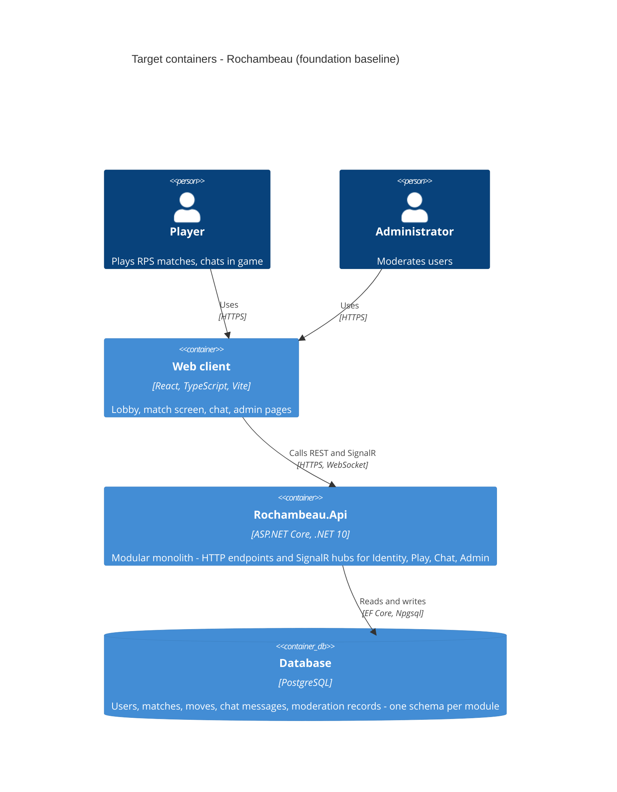

# Architecture map — Rochambeau

> **Greenfield foundation.** No code exists yet. This map describes the **target baseline** that
> `scaffold` will build, plus the conventions every later feature follows. It was produced by
> `survey` (greenfield mode) from `docs/idea-brief.md` and the owner's choices on 2026-11-13.
> Re-run `survey` after `scaffold` so the map cites real files.

## Stack

- **Backend runtime:** .NET 10 (LTS) with ASP.NET Core. See ADR [0001](adr/0001-use-dotnet-react-postgres-signalr-stack.md).
  The local SDK is currently 9.0.301; the **.NET 10 SDK must be installed** before scaffolding.
- **Real-time:** ASP.NET Core SignalR (WebSockets, with automatic transport fallback).
- **Auth:** ASP.NET Core Identity with cookie authentication. The SPA is served from the same origin as the API. Identity's token endpoints remain available for future native clients.
- **API surface:** Minimal API endpoints grouped per module. OpenAPI document via `Microsoft.AspNetCore.OpenApi`.
- **Datastore:** PostgreSQL via EF Core and Npgsql. See ADR [0003](adr/0003-use-ef-core-single-dbcontext-schema-per-module.md).
- **Frontend:** React + TypeScript built with Vite. Styling with Tailwind CSS. Routing with React Router. Server state with TanStack Query. Real-time client `@microsoft/signalr`. Package manager npm. **Node.js LTS must be installed.**
- **Build / test / lint:**
  - Backend: `dotnet build` / `dotnet test` (xUnit) / `dotnet format --verify-no-changes`, with analyzers and `TreatWarningsAsErrors` in `Directory.Build.props`.
  - Frontend: `npm run build` / `npm test` (Vitest + React Testing Library) / `npm run lint` (ESLint + Prettier check).
- **Local infrastructure:** `docker compose` runs PostgreSQL. Integration tests use Testcontainers. **Docker Desktop must be installed.**

## C4 — system as it is

The diagram shows the target baseline after scaffold plus the core-play modules. Nothing exists yet.

## Module inventory

The target modules follow ADR [0002](adr/0002-use-modular-monolith-with-feature-folders.md). There are no paths yet; scaffold creates them.

| Module | Path | Layers | Wired at | Responsibility |
|---|---|---|---|---|
| Host | `src/Rochambeau.Api/` | composition root | `src/Rochambeau.Api/Program.cs` (target) | Wires modules, auth, SignalR, ProblemDetails, OpenAPI. Serves the built SPA in production. |
| Common | `src/Rochambeau.Api/Common/` | shared kernel | — | Error/result types, ID generation, clock abstraction, persistence base (`AppDbContext`) |
| Identity | `src/Rochambeau.Api/Modules/Identity/` | Domain / Application / Infrastructure / Endpoints | `IdentityModule.cs` (target) | Registration, login, profile, roles |
| Play | `src/Rochambeau.Api/Modules/Play/` | Domain / Application / Infrastructure / Endpoints + Hubs | `PlayModule.cs` (target) | Matchmaking (random or chosen opponent), server-authoritative match state, results |
| Chat | `src/Rochambeau.Api/Modules/Chat/` | Domain / Application / Infrastructure / Hubs | `ChatModule.cs` (target) | In-game chat messages |
| Admin | `src/Rochambeau.Api/Modules/Admin/` | Domain / Application / Infrastructure / Endpoints | `AdminModule.cs` (target) | Moderation (e.g. banning users) |
| Competitions | `src/Rochambeau.Api/Modules/Competitions/` | same | — | Later roadmap step: tournaments and leagues |
| Forum | `src/Rochambeau.Api/Modules/Forum/` | same | — | Later roadmap step: build or integrate (open question in the brief) |
| Web client | `web/` | `src/features/<feature>/`, `src/shared/` | `web/src/main.tsx` (target) | SPA |

Scaffold creates only Host, Common and the empty test projects. Feature modules appear with their features.

## Conventions (cited — the rules a new feature must match)

These are target conventions. Scaffold materialises the first example of each, and the citations become real after the next `survey`.

- **Module wiring / registration:** each module has a static `<Name>Module` class with `Add<Name>Module(this IServiceCollection, IConfiguration)` and `Map<Name>Module(this IEndpointRouteBuilder)`. `Program.cs` calls both and nothing else module-specific.
- **Module boundaries:** a module may only call another module through that module's `Contracts/` namespace, which holds public interfaces and DTOs. It never touches another module's entities or tables. Within a module the layers are `Domain → Application → Infrastructure/Endpoints/Hubs`, and Domain has no framework dependencies.
- **Error handling:** domain and application code return `Result<T>` / `Error` (code, message, type) instead of throwing for expected failures. HTTP maps errors to **ProblemDetails (RFC 9457)** with an `errorCode` extension. Hub methods return a typed `HubResult<T>`. Unexpected exceptions go to the global exception handler → 500 ProblemDetails.
- **IDs:** `Guid` generated in the application layer with `Guid.CreateVersion7()` (time-sortable UUIDv7). The database does not generate keys.
- **Time:** inject `TimeProvider`; never call `DateTime.UtcNow` directly. Store `timestamptz` in UTC.
- **Persistence / DB access:** a single `AppDbContext`. Each module contributes `IEntityTypeConfiguration<T>` classes and maps to its own PostgreSQL schema (`identity`, `play`, `chat`, `admin`). snake_case naming via `EFCore.NamingConventions`. The database is plain storage: no stored procedures or triggers.
- **Migrations:** EF Core migrations in `src/Rochambeau.Api/Common/Persistence/Migrations/`, named `<yyyyMMddHHmmss>_<PascalCaseName>` (the EF default). Every migration must have a working `Down`. The app applies them in development; deployment applies them with an explicit `dotnet ef database update`, never automatically.
- **Real-time:** one hub per module (`/hubs/play`, `/hubs/chat`). The server is authoritative: a player's move is stored hidden on the server and broadcast only after both moves are committed. Clients never decide outcomes.
- **Tests:**
  - Unit tests: `tests/Rochambeau.UnitTests/<Module>/` (xUnit, no I/O).
  - Integration tests: `tests/Rochambeau.IntegrationTests/<Module>/` (xUnit + `WebApplicationFactory` + Testcontainers PostgreSQL, one container per test collection).
  - Frontend tests: colocated `*.test.tsx` files (Vitest + React Testing Library).
- **Inter-module communication:** direct in-process calls through `Contracts/` interfaces. No message broker.
- **UI / styling:** Tailwind CSS utility classes. Shared primitives live in `web/src/shared/ui/`. Feature screens live in `web/src/features/<feature>/` (details under Frontend / UI foundation below).
- **CI:** a single GitHub Actions workflow (`.github/workflows/ci.yml`) runs `build_cmd`, `test_cmd` and `lint_cmd` on push and pull request.

## Datastores

| Store | Engine | Accessed via | Notes |
|---|---|---|---|
| Main database | PostgreSQL 17 | EF Core and Npgsql (`AppDbContext`) | One schema per module. Local instance via `docker-compose.yml`. Tests use Testcontainers. |

## Frontend / UI foundation

There is no frontend yet. This is the target baseline.

- **Component library / design system:** an in-repo `web/src/shared/ui/`, starting empty. Scaffold adds no third-party component kit. Run `/sdd:design-system` before the first UI feature.
- **Design tokens:** the Tailwind theme (`web/src/index.css` with `@theme`). Decided by `design-system`.
- **Styling approach:** Tailwind CSS only. No CSS-in-JS and no CSS modules.
- **Shared primitives:** none yet.
- **State / data-fetching:** TanStack Query for HTTP server state. One SignalR connection hook per hub in `web/src/shared/realtime/`. Local UI state uses React state; there is no global store until one is needed.
- **Closest UI precedent:** none yet. The first core-play screen becomes the precedent.
- **Dev setup:** the Vite dev server proxies `/api` and `/hubs` to the ASP.NET Core app, so cookies stay same-origin. In production the API serves `web/dist` as static files.

## Where things live / closest precedents

- A new backend feature goes in `src/Rochambeau.Api/Modules/<Module>/` as a vertical slice: domain type, application handler, endpoint or hub method, plus an EF configuration and a migration if it needs storage. There is no precedent yet; the first core-play feature sets it.
- A new screen or UI component goes in `web/src/features/<feature>/` and is composed from `web/src/shared/ui/`.
- A new module gets a `<Name>Module.cs`, its own schema and a `Contracts/` folder. It is registered in `Program.cs`.

## Constraints & known tech-debt

- **Prerequisites not installed yet:** .NET 10 SDK (only 9.0.301 is present), Docker Desktop and Node.js LTS. Scaffold's smoke test cannot pass without them.
- **No git remote:** CI cannot run until the repo is pushed to GitHub.
- **Solo developer, 1–2 hours a day** (idea brief §5): prefer the simplest thing that keeps module boundaries intact. Add no infrastructure (broker, cache, separate services) without an ADR.
- **Web first** (idea brief §5): desktop and mobile come later. Keep the HTTP and SignalR API client-agnostic so they can be added without changing the server.

## Reconciliation with the authored architecture doc

The owner's course project «Rochambeau-Online» describes a **target** high-load service architecture. It is summarised in [`target-architecture.md`](target-architecture.md), including a table mapping target services to modules. This map stays the reference for what exists. The target is the destination, reached by measured extraction, one ADR per mechanism ([ADR-0004](adr/0004-evolve-monolith-toward-target-service-architecture.md)). Where the target conflicts with a convention here (broker, caches, one database per service, stored procedures), this map wins until an ADR changes it. Product intent comes from `docs/idea-brief.md`.
