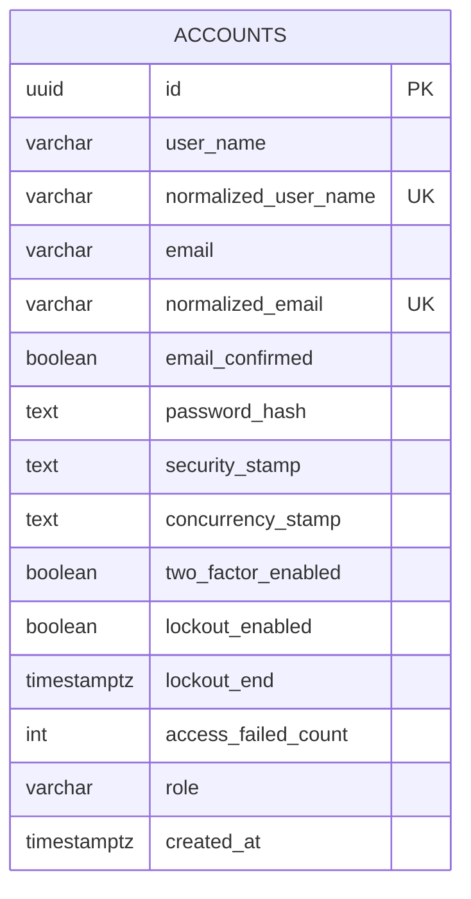

# Data model — accounts

> **Upstream:** [spec](spec.md) §5, §6.1 · [SAD](sad.md) §5, §6, §8 · accounts ADR [0001](adr/0001-use-identity-core-with-module-owned-mappings.md), [0002](adr/0002-validate-cookie-security-stamp-on-every-request.md), [0003](adr/0003-store-one-role-per-account-in-a-column.md) · repo ADR [0003](../../adr/0003-use-ef-core-single-dbcontext-schema-per-module.md) · [architecture map](../../architecture-map.md) · Persistence, Migrations.
> **Staged migrations:** [`migrations/`](migrations/). `implement` turned them into the live EF Core migration `Common/Persistence/Migrations/20261114133227_AddIdentityAccounts.cs`.

## Aggregates

**One aggregate root: `Account`** (table `identity.accounts`), owned by the Identity module. It holds the credentials, the public Username, the email address, the single role (accounts ADR-0003), the lockout state (AC-06), and the security stamp (AC-13b, accounts ADR-0002). The Profile is a read view of the same row, not a separate entity:
- own Profile = username, email, join date, role (AC-09);
- public Profile = username, join date, role (AC-11).

Deliberately **not** persisted by this feature:
- **Sessions.** They live in the encrypted cookie. There is no session table (accounts ADR-0002).
- **Registration-cap counter.** It is in-process memory only. The network address is never stored with the Account (SAD §8, spec §6.1).
- **Data Protection key ring.** It is a directory on the host file system (`DataProtection:KeysPath`, SAD §8), not a table.
- **Identity side tables** (`roles`, `user_roles`, `user_claims`, `user_logins`, `user_tokens`). They are not mapped (accounts ADR-0001, ADR-0003). Login and token tables arrive with 2FA (roadmap step 13).

Other modules store only `account_id` (a UUID) and reach Account data through `Modules/Identity/Contracts/` (accounts ADR-0004). No foreign key points into `identity.accounts` yet. When Play (step 3) references an Account, it decides then whether to add a cross-schema FK.

## ER diagram

A single entity with no relationships in this step. The table is `identity.accounts`; Mermaid entity names cannot carry a schema prefix.

## Entities

Conventions followed (repo, not invented here):
- snake_case names via `EFCore.NamingConventions` (repo ADR-0003);
- UUIDv7 keys generated in the application layer, never by the database (`CLAUDE.md` · IDs);
- `timestamptz` in UTC, written from `TimeProvider`, with no database `DEFAULT` (`CLAUDE.md` · Time);
- no triggers or stored procedures (architecture map · Persistence).

The column shape follows what `IdentityDbContext` would map for `IdentityUser<Guid>`, minus the columns ignored below (accounts ADR-0001).

### `identity.accounts`

| Column | Type | Constraints | Notes |
|---|---|---|---|
| `id` | `uuid` | PK `pk_accounts` | `Guid.CreateVersion7()` set before `UserManager.CreateAsync` (accounts ADR-0001). The only Account reference other modules store. |
| `user_name` | `varchar(20)` | NOT NULL | Username as the owner typed it, after trimming (AC-02, AC-03). 3–20 Latin letters, digits, `_`, `-`, checked in Domain. |
| `normalized_user_name` | `varchar(20)` | NOT NULL, UNIQUE (`ix_accounts_normalized_user_name`) | Identity `ILookupNormalizer` (upper-invariant). The username is ASCII-only, so the length never changes. Race guard for AC-03b. |
| `email` | `varchar(256)` | NOT NULL | Shown only to the owner (AC-09, spec §6.1). The 256 matches the Identity default. The Domain rule caps an email at 254 characters (RFC 5321 path limit, `EmailAddress.MaxLength`), so an overlong email is a field error, never a 500. |
| `normalized_email` | `varchar(256)` | NOT NULL, UNIQUE (`ix_accounts_normalized_email`) | Made **unique** on purpose. Identity's default email index is not (accounts ADR-0001). Race guard for AC-03b. |
| `email_confirmed` | `boolean` | NOT NULL | Always `false` in this step. Email confirmation is a spec §3 non-goal. Mapped because `SignInManager` reads it. |
| `password_hash` | `text` | NOT NULL | Identity `PasswordHasher` (PBKDF2) output. The password is never stored readable (spec §6.1). |
| `security_stamp` | `text` | NOT NULL | Compared on every request and hub call (accounts ADR-0002, ADR-0004). Rotated by `ChangeRole` (AC-13b). |
| `concurrency_stamp` | `text` | NOT NULL, EF concurrency token | Identity optimistic concurrency, as `IdentityDbContext` configures it. |
| `two_factor_enabled` | `boolean` | NOT NULL | Always `false` until 2FA (roadmap step 13). Mapped because `SignInManager` reads it. |
| `lockout_enabled` | `boolean` | NOT NULL | `true` for every new Account (`Lockout.AllowedForNewUsers`). |
| `lockout_end` | `timestamptz` | NULL | UTC end of the 15-minute block (AC-06). NULL = never locked. |
| `access_failed_count` | `integer` | NOT NULL | Consecutive failures. Reset to 0 when the block starts and on a successful login (AC-06). |
| `role` | `varchar(20)` | NOT NULL, CHECK `ck_accounts_role` | `player` \| `administrator`, written in lower case by an EF value converter from `AccountRole`. Registration always writes `player`. Only the operator command changes it (accounts ADR-0003, AC-14). |
| `created_at` | `timestamptz` | NOT NULL | Join date (AC-09, AC-11). Set once from `TimeProvider` at registration. |

**Aggregate root:** root.
**Constraints:**
- PK on `id`.
- UNIQUE on `normalized_user_name` and on `normalized_email`.
- `CHECK (role IN ('player', 'administrator'))`.
- No FKs.

**Not mapped (`builder.Ignore`):** `PhoneNumber`, `PhoneNumberConfirmed`. Spec §6.1 lists no phone number as personal data, so the database is kept unable to hold one. They come back through an expand migration if a later step needs them.

**Audit columns:** `created_at` only. No AC reads an update time. An `updated_at` would also change on every login and failed attempt.

**Delete strategy:** none in this step. Nothing deletes an Account. A ban (roadmap step 6) chooses its own strategy.

**Unique-violation mapping:** a race that reaches the database (AC-03b) surfaces as PostgreSQL error `23505`. Its constraint name tells the two cases apart:
- `ix_accounts_normalized_user_name` → `identity.username_taken`;
- `ix_accounts_normalized_email` → the «email cannot be used» error.

Keep these index names stable. Application code matches on them.

**Adding `moderator` later:** it takes a migration that drops and re-adds `ck_accounts_role` with the wider set. That is the accepted cost of the CHECK.

## Indexes

| Index | Columns | Query it serves |
|---|---|---|
| `pk_accounts` (PK) | `id` | Read Account by primary key, once per request or hub call, to compare the security stamp (SAD §6 cross-cutting flow, critical flow 2; AC-08, AC-13b). Own Profile read (AC-09). `IAccountDirectory` lookup by id. |
| `ix_accounts_normalized_user_name` (UNIQUE) | `normalized_user_name` | Public Profile by exact Username, letter case ignored, no partial match (AC-11, AC-12). The operator command's username lookup (AC-13). Uniqueness and race guard at registration (AC-03, AC-03b). |
| `ix_accounts_normalized_email` (UNIQUE) | `normalized_email` | Log in by normalised email (SAD §6 log-in flow; AC-04, AC-05, AC-06). Uniqueness and race guard at registration (AC-03, AC-03b). |

No other index. Nothing in this feature queries by `role`, `lockout_end` or `created_at`. There are no FKs, so no FK indexes are needed.

## Seeds

- **Bootstrap:** none. No Administrator is seeded. The role is granted only by the operator command on the host (AC-13, AC-14).
- **Lookup data:** none. `role` is a CHECK-bounded string, not a lookup table.

## Test fixtures

Test fixtures do not go in migrations. They use the repo's integration-test form: `ApiFactory` + `PostgresFixture` in `tests/Rochambeau.IntegrationTests/Infrastructure/`, with helpers in `tests/Rochambeau.IntegrationTests/Identity/`.

- `RegisterAsync(client, username?, email?, password?)`: registers through the real register endpoint and returns the logged-in client.
  - Defaults: username `player_<n>`, email `user-<uuid>@example.test`, password `test-password-8`.
  - Going through the endpoint means the fixtures exercise the same normalisation and constraints as AC-01 to AC-03b.
- `PromoteToAdministratorAsync(services, username)`: runs the same `ChangeRole` handler that the operator command uses (AC-13, AC-13b). It never writes `role` directly.
- Unit tests (`tests/Rochambeau.UnitTests/Identity/`) need no persisted fixtures. They test Domain rules and `RegistrationCap` with a fake `TimeProvider`.
- PII guard: only `@example.test` emails and synthetic usernames such as `player_1`, `Rocky`, `Paper` and `Scissors` (the spec's own examples).
