# Software Architecture Document — accounts

> **Upstream:** [spec](spec.md) · [CONTEXT](../../../CONTEXT.md) (repo-root glossary; no feature-scoped one) ·
> [architecture map](../../architecture-map.md) · repo ADRs [0001](../../adr/0001-use-dotnet-react-postgres-signalr-stack.md),
> [0002](../../adr/0002-use-modular-monolith-with-feature-folders.md), [0003](../../adr/0003-use-ef-core-single-dbcontext-schema-per-module.md),
> [0004](../../adr/0004-evolve-monolith-toward-target-service-architecture.md). Feature ADRs live in [`adr/`](adr/) and are
> cited as «accounts ADR-NNNN» to keep them apart from the repo-level ADRs.

<!-- 12 Arc42 sections. Empty section → <!-- N/A: <one-line reason> -->. -->
<!-- C4 Context (L1) lives inline in §3. C4 Container (L2) lives inline in §5. -->
<!-- Numbers in §10 come VERBATIM from spec.md §6 NFR — no inventing, no rounding. -->

## 1. Introduction and goals

<!-- 🎯 Why: durable memory of «what + the three dominant qualities + who cares». A year from
     now nobody recalls which three qualities were critical for this system.
     📋 Write: 1 ¶ intent + 3 lines of top-3 quality goals + a stakeholders table.
     ¶4 is the override slot — critic `Override` resolutions emit «Decision override: <headline>
     — rationale: <reason>» bullets here so downstream skills see the deliberate choice. -->

**Intent.** Accounts gives Rochambeau identity. A Visitor registers with a Username, an email address and a password and becomes a Player who is logged in right away. A Player logs in and out, sees their own Profile (including their private email), and opens another Player's public Profile by exact Username. The Administrator role exists from day one; the portal's operator grants it outside the portal. Accounts is also the identity seam for the rest of the monolith: Play (roadmap step 3), Chat (step 5) and Admin (step 6) learn *who is acting* only through Accounts' public contract — account identity, Username and role — and never through its tables (spec §2, AC-08).

**Top quality goals (4) (1-liners; full scenarios in §10):**

1. **Security of credentials and personal data:** no account enumeration through login, temporary lockout after repeated failures, a registration cap per network address, the email never shown to anyone but its owner, and a role change that applies on every device (spec §6.1, AC-05, AC-06, AC-11, AC-13b, AC-15).
2. **Integrity of identity:** exactly one Account per Username (letter case ignored) and per email address, even when two registrations race (AC-03, AC-03b, spec §7 «Duplicate usernames»).
3. **Responsive account flows:** register, log in and view a profile within the spec §6 latency targets, and a session that lasts until logout or idle expiry (spec §6).
4. **A stable identity seam for downstream modules:** steps 3 and 6 can be specified using only this feature's public identity (spec §7 «Downstream readiness»), and later 2FA, a Moderator role and token login extend it without reshaping it (spec §3).

**Stakeholders.**

| Role | Interest | Sign-off owner? |
|---|---|---|
| Visitor | Registers or logs in; sees no Profile details (AC-01–AC-06, AC-10, AC-15) | No |
| Player | Stays logged in, logs out, sees own and others' Profiles (AC-07–AC-12) | No |
| Administrator | Is recognised by role once moderation tools exist (AC-13, AC-13b) | No |
| Portal operator | Grants or removes the administrator role outside the portal (AC-13, AC-13b, AC-14) | No |
| Downstream modules (Play, Chat, Admin) — owner a.udalov | Consume the acting Player's identity, Username and role (AC-08) | No |
| Security Lead | Reviews the new authentication boundary and personal data (spec §6.1 «Security review: Required») | Yes |
| Tech Lead (a.udalov) | SAD approval | Yes |

<!-- Decision overrides (¶4) — populated by the critic resolution loop, empty otherwise. -->

**Decision overrides.**
- Decision override: module layers gain a `Commands/` entry adapter (next to Endpoints / Hubs), and `Program.cs` gains one generic operator-command dispatch line — rationale: AC-13/AC-14 require the administrator role to be granted outside the portal by the operator, through the same handler that rotates the security stamp. A generic hook in `Common/Commands/` keeps `Program.cs` free of module-specific code, which is the intent of `CLAUDE.md` · Layout. `CLAUDE.md` and `architecture-map.md` are updated to list the new layer (§11).

## 2. Constraints

<!-- 🎯 Why: §4 strategy only works when §2 has fixed WHAT IS ALREADY FIXED — stack, versions,
     deadline, regulatory. This is an input, not an output.
     📋 Write: four blocks — Technical / Organisational / Conventions / Regulatory.
     📌 Pin versions («<datastore> 18», not «<datastore>»); «Q3 deadline — hard», not «ideally».
     Never N/A — every feature inherits at least Conventions + Technical. -->

**Technical.**
- C# on .NET 10 (pinned by `global.json`); ASP.NET Core 10 Minimal APIs + SignalR (repo ADR-0001).
- Authentication: ASP.NET Core Identity with cookie authentication; the SPA is same-origin with the API (`CLAUDE.md` · Auth, `architecture-map.md` · Stack).
- PostgreSQL 17 through EF Core 10 + Npgsql 10.0.3, `EFCore.NamingConventions` 10.0.1 (snake_case) — `src/Rochambeau.Api/Rochambeau.Api.csproj`, `docker-compose.yml`.
- Web client: React 19 + TypeScript ~6.0 + Vite, React Router 8, TanStack Query 5, Tailwind CSS 4 (`web/package.json`).
- Modular monolith with feature folders (repo ADR-0002); one `AppDbContext`, one schema per module, UUIDv7 keys (repo ADR-0003); evolve toward the target service architecture one measured ADR at a time (repo ADR-0004). This feature keeps the ADR-0004 seam «keep authentication apart from roles/permissions inside Identity's contracts» (`target-architecture.md` · Target services).
- Client-agnostic server: no browser-only behaviour on the server, so a token login for desktop/mobile can be added later (spec §1, §3 «Token-based login»).

**Organisational.**
- Solo developer, 1–2 hours a day, no deadline (`idea-brief.md` §5, spec §1).
- Accounts blocks roadmap steps 3 (match vs chosen opponent) and 6 (moderation) — `roadmap.md` dependency graph.
- Reviewers: Tech Lead and Security Lead roles, both held by the owner (spec frontmatter).

**Conventions.**
- `CLAUDE.md` · Conventions and `architecture-map.md` · Conventions: module wiring through `Add<Name>Module` / `Map<Name>Module`; cross-module calls only through `Contracts/`; layers `Domain → Application → Infrastructure / Endpoints / Hubs`, Domain free of framework types.
- Expected failures return `Result<T>` / `Error` → ProblemDetails (RFC 9457) with an `errorCode` extension; hub methods return `HubResult<T>`; unexpected exceptions → global handler → 500.
- `Guid.CreateVersion7()` generated in the application layer; inject `TimeProvider`; `timestamptz` in UTC; every migration has a working `Down`; only Development auto-migrates.
- Warnings are errors (`Directory.Build.props`); add no broker, cache or separate service without an ADR.

**Regulatory / external.**
- No formal compliance regime: a portfolio project with no real audience (`idea-brief.md` §5). Data classification is **confidential** (spec §6.1).
- Personal data is limited to the email address (owner-only). Passwords are stored only as a one-way protected value. The network address used by the registration cap is held for the rolling 60 minutes only and never stored with the Account (spec §6.1).
- A security review is required before shipping: this is a new authentication boundary with new personal data (spec §6.1).

## 3. Context and scope

<!-- 🎯 Why: draws the SYSTEM BOUNDARY — who talks to it from outside, where the trust zone ends.
     Without §3, §5 and §8 (authorization) blur — unclear what's «inside» vs «outside».
     📋 Write: 2–3 sentences of business context + an external-systems table + a C4Context block.
     📌 «External: none (deliberate, no third-party in v1)» is itself a decision worth stating.
     Trust boundary — the line past which you don't trust data without checking it.
     Never N/A — greenfield still draws the planned actors + external systems. -->

Rochambeau is a web portal for real-time rock-paper-scissors between named people. Accounts is the first feature built on the scaffold. It turns an anonymous Visitor into an identified Player and draws the portal's authentication boundary: everything on the server past the login check trusts the account identity Accounts provides, and nothing else. The portal's operator stands outside that boundary. They act on the host through an operator command, never through the portal's own UI or API (AC-14).

<!-- brownfield: scaffold only (commit e0be70d) — Host `Program.cs` (ProblemDetails, OpenAPI, TimeProvider, SignalR, health), `Common/Persistence` (`AppDbContext`, `InitialCreate` migration), empty `Modules/`, empty `web/src/features/`. No `Result<T>`/`Error` types exist in `Common/` yet. `architecture-map.md` is stale (reflects 079e702, pre-scaffold); re-run `/sdd:survey` after this feature. -->

**External systems (in / out):**

| Actor or system | Type | Interaction |
|---|---|---|
| Visitor | Person | Registers or logs in through the web client (US-01, US-02) |
| Player | Person | Logs out, views own and other Players' Profiles (US-03–US-05) |
| Administrator | Person | Logs in and is recognised by role (US-06) |
| Portal operator | Person | Grants or removes the administrator role through an operator command on the host (AC-13, AC-13b) |
| External systems | — | **None, deliberately.** No email provider (spec §3: no email confirmation or reset) and no third-party login (spec §3). |

**C4 Context (L1):**

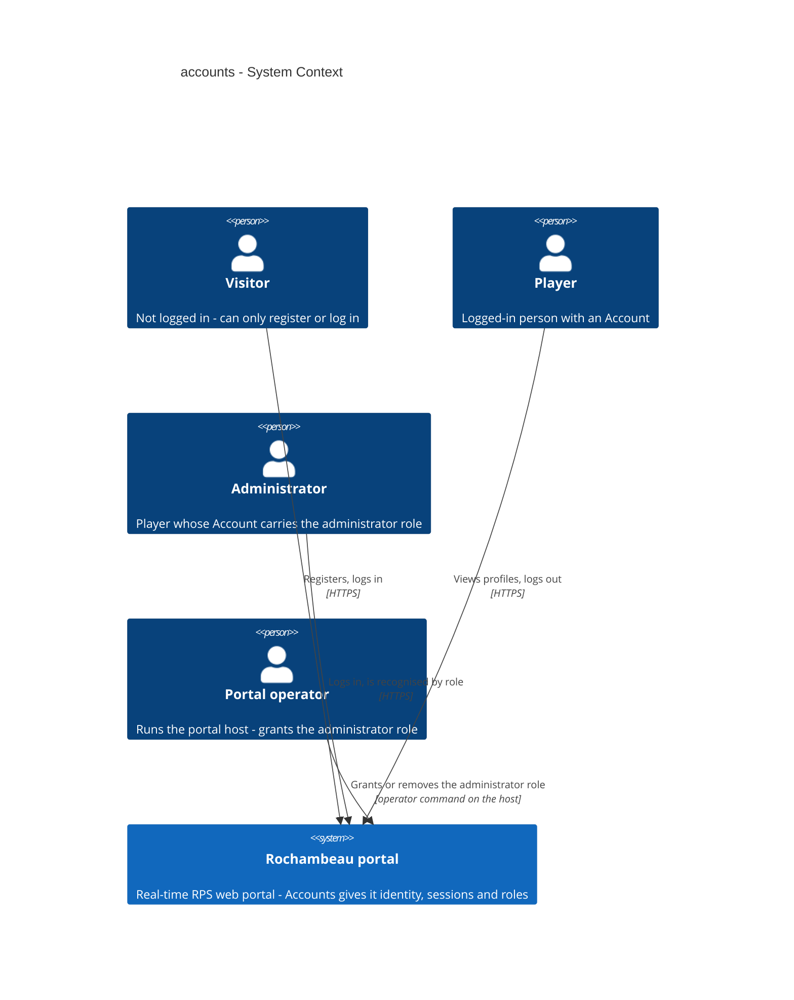

## 4. Solution strategy

<!-- 🎯 Why: the 3–4 STRATEGIC PILLARS every ADR grows from. Without §4 each ADR looks random —
     there's no umbrella. ⭐ The densest section — the blast-radius gate fires almost always here
     (decisions are irreversible + multi-module).
     📋 Write: 3–4 choices; each a heading + 2–3 sentences of rationale.
     📌 «Store content as a table of typed blocks» is a pillar — ADR-0001 grows from it. -->

**Target surfaces: `[backend-service, web-frontend]`.** The backend surface is the new Identity module inside `Rochambeau.Api` (HTTP endpoints, the identity contract for other modules, and the operator command). The web surface is the registration, login and Profile screens in the existing SPA. Both are needed: the spec §7 KPI is a scripted end-to-end demo where a Visitor reaches their logged-in Profile in ≤ 60 s. Inline, no ADR: adding the web surface later would not need ≥ 3 days of rework, and the only alternative (backend-only) fails the KPI.

**UI architecture (web-frontend): client-side SPA.** React + React Router + TanStack Query, same-origin with the API. This is already fixed by repo ADR-0001 and `architecture-map.md` · Frontend, so it needs no feature ADR (the alternatives are excluded by that constraint). Screens go in `web/src/features/auth/` and `web/src/features/profile/` and are composed from `web/src/shared/ui/`. There is no `docs/design-system.md` yet, so screen-level design belongs to `/sdd:design-system` and `/sdd:screens`, not to this SAD.

**Top strategic choices (the seeds for ADRs):**

1. **Use ASP.NET Core Identity core, mapped by the Identity module itself** → [accounts ADR-0001](adr/0001-use-identity-core-with-module-owned-mappings.md). `AddIdentityCore<Account>` + `SignInManager`, with Identity's EF stores running over the plain `AppDbContext`. The Identity module's own `IEntityTypeConfiguration` classes map the tables into the `identity` schema. Password hashing, lockout (AC-06), case-insensitive normalisation (AC-03) and the security stamp (AC-13b) come built in. `Common/` never references an Identity type, so repo ADR-0002/0003 and the ADR-0004 extraction seam hold (quality goals 1, 2, 4).
2. **Keep sessions in an encrypted cookie and validate the security stamp on every request** → [accounts ADR-0002](adr/0002-validate-cookie-security-stamp-on-every-request.md). The Identity cookie has a 7-day sliding lifetime. `SecurityStampValidator` runs with a zero interval: on every authenticated request it re-checks the stamp and re-issues the cookie. The idle logout therefore lands exactly 7 days after the last activity, inside the spec's «no earlier than 3.5, no later than 7 days» window (AC-08). A role change rotates the stamp and invalidates every device's cookie on its next request (AC-13b). Logout clears only this browser's cookie (AC-07). No session table is added (quality goals 1, 3).
3. **Store exactly one role per Account in a column** → [accounts ADR-0003](adr/0003-store-one-role-per-account-in-a-column.md). A `role` value (`player` | `administrator`; `moderator` later) on the account row, emitted as a standard role claim. It matches the glossary («an Account has … a role») and the single role shown on a Profile (AC-09, AC-11). It also keeps the escalation surface to one column that only the operator command writes (AC-14) (quality goals 1, 4).
4. **Expose identity to other modules only through the Identity `Contracts/`** → [accounts ADR-0004](adr/0004-expose-acting-account-through-identity-contracts.md), detailed in §5. Play, Chat and Admin never read claims, cookies or `identity.*` tables directly (AC-08, quality goal 4).

Each tactical decision in later sections should trace to one of these seeds. Tactical decisions that *contradict* a strategic choice are red flags — surface them in §11.

## 5. Building block view

<!-- 🎯 Why: INTERNAL DECOMPOSITION — modules, containers, datastores. The static topology: who
     may talk to whom. Without §5, §6 (the flows) has no vocabulary of participants.
     📋 Write: 1 ¶ on the style (layered / hexagonal / clean / event-driven) + a folder tree + a
     C4Container block.
     📌 Draw ONE Container per declared `target_surface` (frontmatter): a fullstack
     [backend-service, web-frontend] = a backend-API container + a web/SPA container; a
     [backend-service, mobile-app] = the API + the mobile app. The Container(web, …) line below is
     just one surface's container — swap/add per what was declared in §4. → _shared/surfaces.md
     📌 e.g. «web app, content API, media worker, datastore, object store, CDN». -->

Accounts is a **new module, `Identity`**, inside the existing `Rochambeau.Api` host. It is a vertical slice laid out per the repo convention: `Domain → Application → Infrastructure / Endpoints`, plus `Contracts/` as its only public face (repo ADR-0002, `CLAUDE.md` · Layout). Nothing new is deployed. The module adds an endpoint group, a hub filter that every module's hubs run, an operator command in the same executable, and the `identity` schema in the shared `AppDbContext` (accounts ADR-0001). Accounts is the first feature that needs expected-failure results. It therefore introduces `Result<T>` / `Error` and their ProblemDetails mapping in `Common/` as the precedent every later module reuses. On the web side, the feature adds two feature folders and a small shared API client to the existing SPA.

**Internal decomposition:**

```
src/Rochambeau.Api/
├── Common/
│   ├── Results/          Result<T>, Error (code, message, type): new, first user
│   ├── Http/             Error -> ProblemDetails with errorCode; client-header filter (accounts ADR-0005): new
│   ├── Commands/         generic operator-command registry and the single Program.cs dispatch hook: new
│   └── Persistence/      AppDbContext: unchanged, never references Identity types
└── Modules/Identity/
    ├── Domain/           Username and password rules, AccountRole, lockout and registration-cap policy values (no framework types)
    ├── Application/      Register, LogIn, LogOut, GetOwnProfile, GetPublicProfile, ChangeRole handlers; RegistrationCap
    ├── Infrastructure/   Account : IdentityUser<Guid>, EF configurations (schema identity), claims-principal factory,
    │                     CurrentAccount + AccountDirectory implementations, SessionRevalidationHubFilter
    ├── Endpoints/        Minimal API group: register, log in, log out, own Profile, public Profile by Username
    ├── Commands/         grant-admin / revoke-admin operator commands: an entry adapter like Endpoints, run from the API executable on the host
    ├── Contracts/        ICurrentAccount, IAccountDirectory, AccountIdentity, AccountRole (accounts ADR-0004)
    └── IdentityModule.cs AddIdentityModule / MapIdentityModule
web/src/
├── shared/api/           fetch wrapper (same-origin cookie, X-Rochambeau-Client header, ProblemDetails parsing), "me" query
├── features/auth/        Register and Log-in screens, log-out action, route guard for logged-in pages
└── features/profile/     Own Profile and public Profile by Username
tests/
├── Rochambeau.UnitTests/Identity/          Domain rules, RegistrationCap with a controlled clock
└── Rochambeau.IntegrationTests/Identity/   Endpoints against Testcontainers PostgreSQL (AC-01 to AC-15, spec §6 timings)
```

**Identity seam for other modules (accounts ADR-0004).** Play, Chat and Admin depend only on `Modules/Identity/Contracts/`:
- `ICurrentAccount` resolves the acting person for the current HTTP request or hub invocation to `AccountIdentity(AccountId, Username, Role)`, or to «nobody» for a Visitor (AC-08).
- `IAccountDirectory` looks an Account up by id or by exact Username, letter case ignored (AC-11, AC-12). It never returns the email.
- Claim names, cookies and `identity.*` tables stay private to the module. A global `SessionRevalidationHubFilter` re-checks the security stamp on every hub method invocation and aborts the connection when the session was revoked. This keeps AC-13b true over long-lived WebSocket connections.

**Operator command.** The operator command (`grant-admin <username>` / `revoke-admin <username>`) is the only writer of the role (accounts ADR-0003). A generic, module-agnostic operator-command mechanism lives in `Common/Commands/`. Each module registers its commands in its `Add<Name>Module`, and `Program.cs` gains one non-module-specific line before it starts the web host: «if the arguments name a registered command, run it and exit». When `grant-admin` or `revoke-admin` is given, the Identity module runs it through the same `ChangeRole` handler, which sets the role and rotates the security stamp (AC-13, AC-13b). The process then exits without serving HTTP. No endpoint can reach that handler (AC-14).

**C4 Container (L2):**

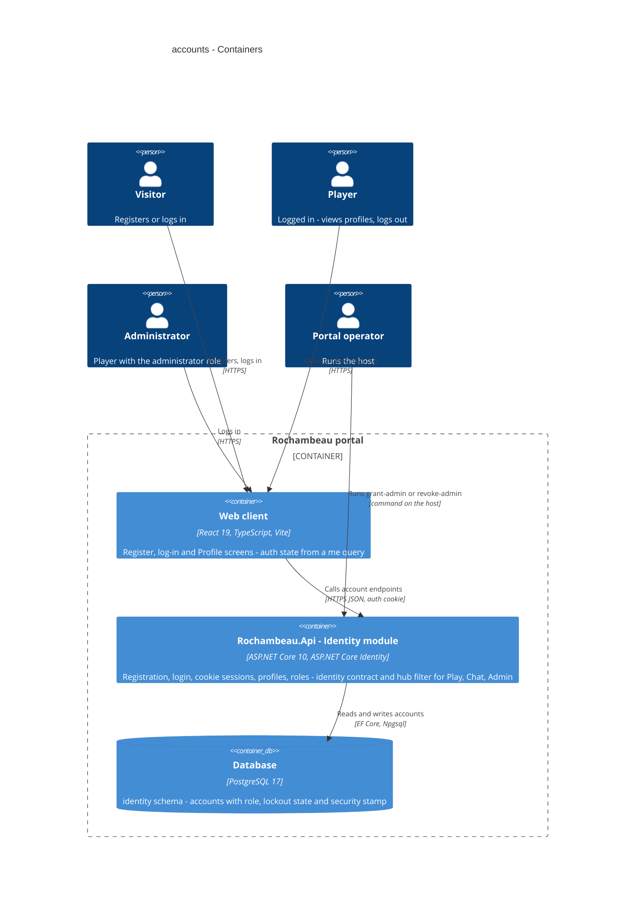

## 6. Runtime view

<!-- 🎯 Why: the RUNTIME FLOW of 1–2 critical scenarios — who talks to whom, when, in what order.
     Without §6, §5 is just boxes with no life.
     📋 Write: a Mermaid sequenceDiagram. Participants are names from §5 (don't invent new ones).
     Messages are semantic («saves a draft»), NO HTTP verbs / paths / status codes — endpoint-level
     sequences arrive at the `api` stage.
     📌 e.g. «author → web: composes draft → web → content API: save». Seed the primary flow(s) here;
     the `sequences` stage then covers every §5 AC (no cap). Never N/A for M+; XS/S keeps ≥1 happy-path flow. -->

Design seeds the two flows that carry the strategic choices. `/sdd:sequences accounts` then covers every §5 AC: log in with lockout (AC-04 to AC-06), log out (AC-07), the Profile reads (AC-09 to AC-12), and the operator command (AC-13).

**Critical flow 1: register (AC-01, AC-02, AC-03, AC-03b, AC-15)**

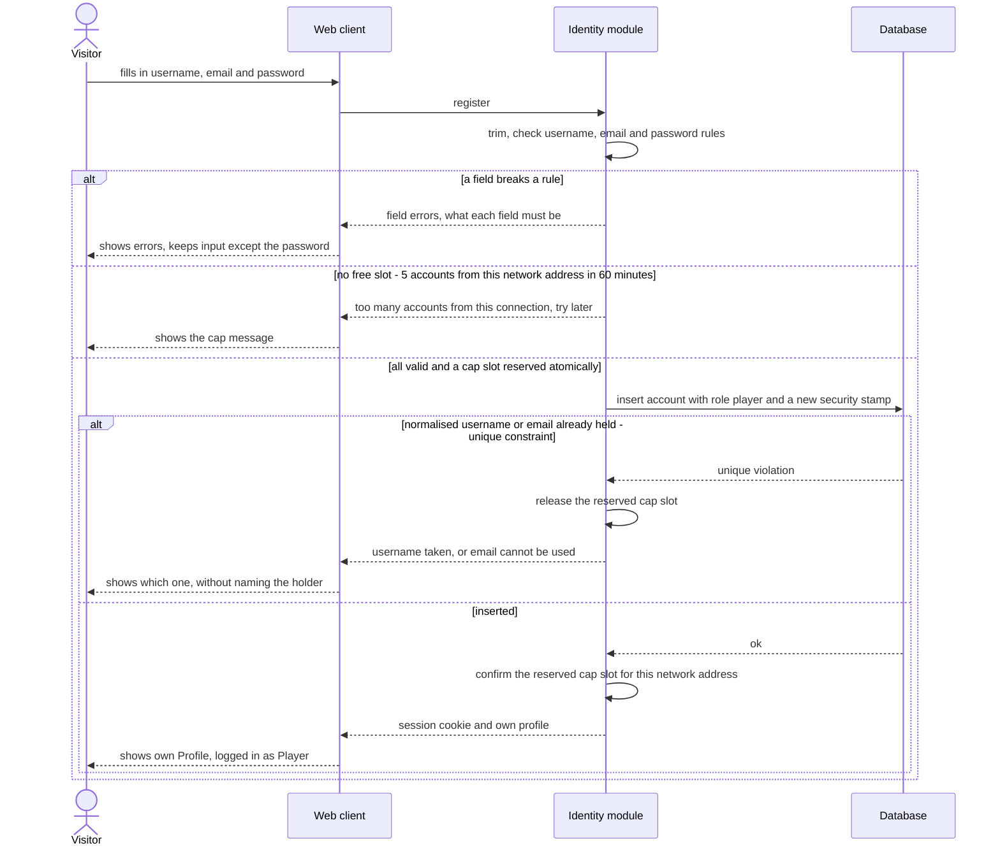

The unique constraints on the normalised Username and email are the only race guard (AC-03b). The application never does a «check, then insert». When two parallel inserts collide, the database rejects the second one, and the Visitor who sent it gets the same «taken» answer as in AC-03.

**Critical flow 2: who is acting, and a role change on every device (AC-08, AC-13b)**

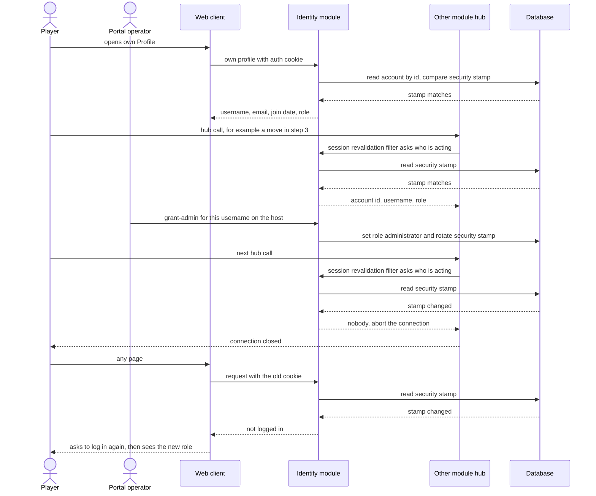

The flows below were added by `/sdd:sequences accounts`. They use the generic runtime vocabulary (`user`, `ui`, `service`, `data-store`, `client`); `service (Identity)` is the module from §5. All are synchronous: the feature has no webhook, queue, scheduled job or third-party callback. Read notes mark lookups that `data-model` must index; persist notes mark every write.

### Log in, with lockout (US-02, US-06 — AC-04, AC-05, AC-06, AC-13)

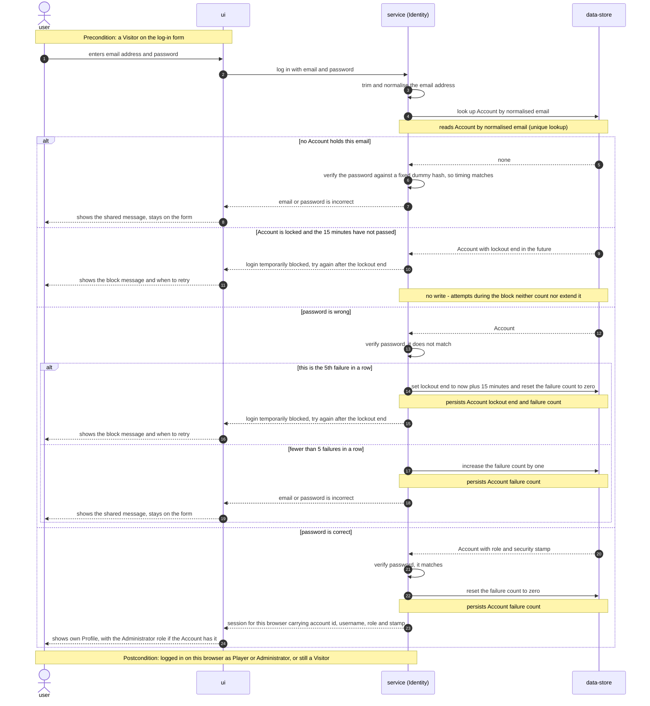

### Log out (US-03 — AC-07)

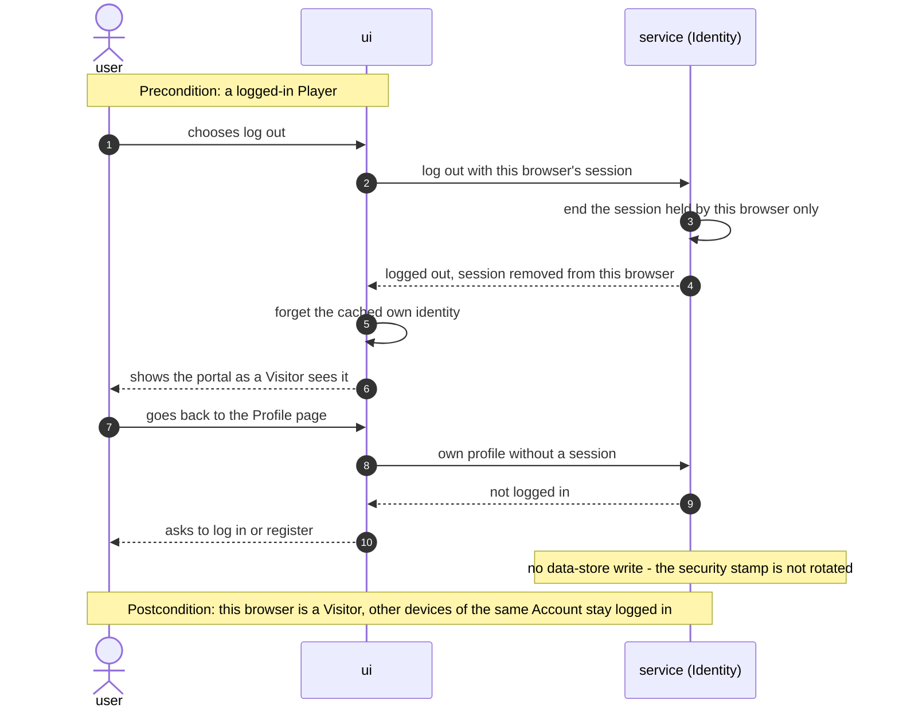

### See my own Profile (US-04, US-06 — AC-09, AC-10, AC-13)

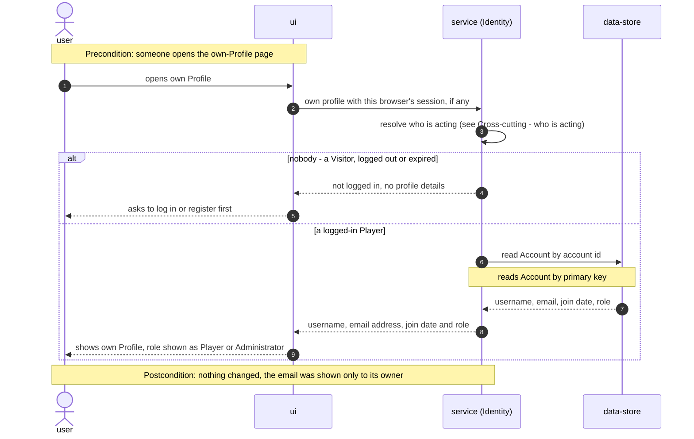

### Look up another Player's Profile (US-05 — AC-10, AC-11, AC-12)

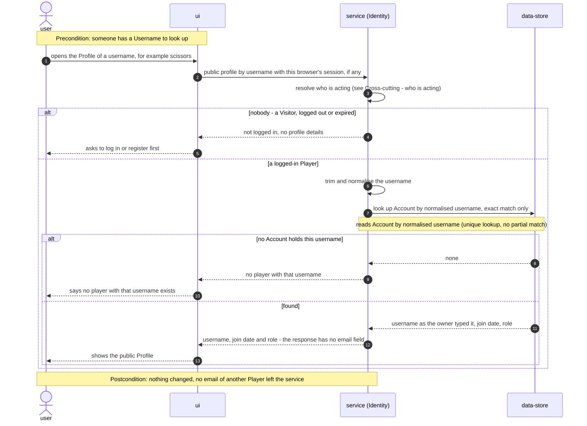

### Operator grants or removes the administrator role (US-06 — AC-13, AC-13b)

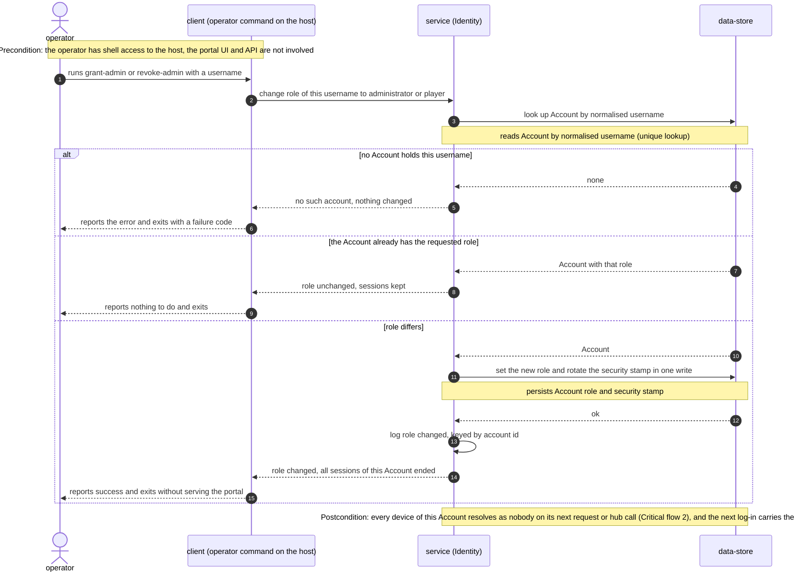

### Self-escalation attempt through the portal (US-06 — AC-14)

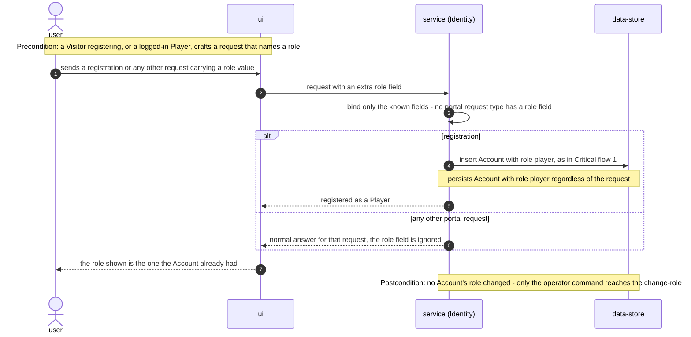

### Cross-cutting: who is acting on each request (AC-08, AC-10, AC-13b)

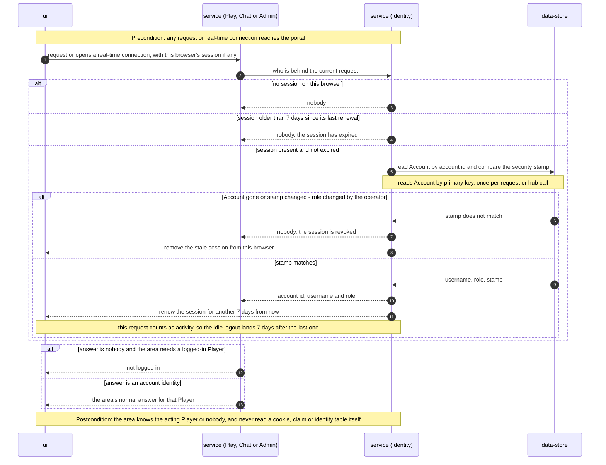

**Flags for design (not decided here):**
- The operator command (`client (operator command on the host)`) and the consuming module (`service (Play, Chat or Admin)`) are participants §5 names in prose but not as C4 containers; §5 treats them as part of the `Rochambeau.Api` container. No change to §5 is proposed.
- Granting a role the Account already has is drawn as a no-op that keeps sessions alive. AC-13b only speaks about a grant or removal that changes the role; if «re-run grant-admin to force a logout everywhere» is wanted, it is a design change.
- The lockout answer on the 5th consecutive failure itself is drawn as «temporarily blocked», which is what Identity returns. AC-06 only requires the block from the next attempt on, so this is stricter, not contrary.

## 7. Deployment view

<!-- 🎯 Why: the TOPOLOGY DevOps must know without reading the deploy charts — how many replicas,
     where the background worker lives, AT WHAT NUMBERS we scale.
     📋 Write: 2–3 sentences on topology + monitoring + concrete threshold numbers.
     📌 e.g. «500 authors → partition by quarter» (not «we'll think about scale later»).
     🎯 N/A allowed for XS/S that reuses an existing deployment unit with no change.
     Deployment-diagram scaffold → templates/deployment.md. -->

Accounts reuses the existing deployment unit. It is one `Rochambeau.Api` process, which in production also serves the built SPA, plus PostgreSQL 17 (`docker compose` locally). No new service, broker or cache is added. No hosting has been chosen yet, so the only target is a local single instance (spec §6 «Throughput / Availability: TBD», spec §8). The deployment changes are:
- one new EF migration creating the `identity` schema, applied with `dotnet ef database update` outside Development;
- a persisted Data Protection key ring, so cookies survive a restart (§8);
- the operator command, run with the same executable and configuration on the host (§5).

**Monitoring:**
- The existing `/health` check (database reachability) covers the new module. No metrics stack exists yet; one arrives with roadmap step 14.
- Structured log events through `ILogger`, keyed by account id and never containing the email or password: account registered, login failed, account locked out, registration cap hit, role changed, hub connection aborted after revocation.
- Alerts and tracing: none in this step. There is no hosting and no on-call (solo portfolio project).

**Scaling thresholds:**
- The spec sets no throughput or availability target (spec §8). The design commits to one instance only.
- Two pieces of state are per instance and must move to shared storage, under an ADR, **before a second instance runs**: the registration-cap counter (§8) and the Data Protection key ring if it lives on the local file system. Both are §11 rows.
- Every authenticated request and hub invocation costs one primary-key read of the account row (accounts ADR-0002, ADR-0004). It is re-measured at the scale milestone (roadmap step 15) before any cache is considered.

## 8. Crosscutting concepts

<!-- 🎯 Why: CROSS-CUTTING PATTERNS spanning several modules: logging, errors, authorization, ID
     strategy, events, caching. ⭐ The second-densest section. A pattern inside one module is NOT
     here; a project-wide convention belongs in the convention file.
     📋 Write: a table — concept / convention / where defined. One row per concept.
     📌 e.g. «sortable time-based IDs generated in the app layer» as a default from the convention file. -->

| Concept | Convention | Where defined |
|---|---|---|
| Authentication | ASP.NET Core Identity application cookie: `HttpOnly`, `Secure`, `SameSite=Strict`, 7-day sliding lifetime, security stamp validated on every request. Unauthenticated API calls get 401 and forbidden ones get 403, with no redirect to a login page. Every module reads the acting person only through `ICurrentAccount` | accounts ADR-0002, ADR-0004 |
| Authorization | A **deny-by-default** fallback policy (authenticated user required) for every endpoint in every module. Only register, log in, `/health`, OpenAPI (Development) and the SPA's static files opt out with `AllowAnonymous`. Role checks use the standard role claim (`Administrator`) | here |
| CSRF | `SameSite=Strict` cookie plus a required `X-Rochambeau-Client` header on every unsafe-method request under `/api` and on SignalR negotiate. No CORS policy is configured | accounts ADR-0005 |
| Error handling | `Result<T>` / `Error` (code, message, type) in `Common/Results/`, mapped to ProblemDetails with an `errorCode` extension. Field-level validation failures (AC-02) are returned as ProblemDetails `errors` keyed by field. Identity codes use an `identity.` prefix (e.g. `identity.username_taken`, `identity.invalid_credentials`, `identity.locked_out`, `identity.registration_cap`) | `CLAUDE.md` · Errors; first implemented here |
| Account enumeration | An unknown email and a wrong password return the same `identity.invalid_credentials` error (AC-05). For an unknown email the server still verifies the password against a fixed dummy hash, so response time does not reveal which emails exist | here |
| Password storage | Identity's default `PasswordHasher` (PBKDF2, a deliberately slow one-way function). The only password rule is length 8–128 (AC-02); Identity's digit/case/symbol requirements are switched off | accounts ADR-0001 |
| Lockout | Identity lockout: 5 consecutive failures → locked for 15 minutes. The count resets when the lock starts and on a successful login; attempts during the lock neither count nor extend it (AC-06) | accounts ADR-0001 |
| Registration cap | An in-process sliding-window counter of **successful** registrations per network address: 5 per 60 minutes (AC-15). The check and the reservation are one atomic step under a per-address lock, done **before** the insert. A failed registration releases its slot, so parallel requests cannot exceed the cap and failed attempts still don't count. It reads time from `TimeProvider` and keeps addresses only in memory, never with the Account (spec §6.1). The address is the connection's remote address until the spec §8 proxy question is answered | here; §11 |
| Normalisation | Trim the username and email before validation (AC-02). Usernames are Latin letters a–z/A–Z, digits, `_` and `-` only, so normalisation is unambiguous. Case-insensitive uniqueness comes from unique indexes on Identity's normalised columns (AC-03, AC-03b) | accounts ADR-0001 |
| Personal data | The email appears only in the owner's own-profile response. The public-profile response type and `AccountIdentity` have no email field at all (AC-09, AC-11). All text is rendered as plain text by React, never as HTML | here |
| ID strategy | `Guid.CreateVersion7()` in the application layer. The account id is the only reference other modules store | `CLAUDE.md` · IDs; accounts ADR-0004 |
| Time | A single `TimeProvider` registration, read by the application layer, Identity lockout and cookie expiry. Integration tests swap in a fake clock for the session-lifetime and lockout checks (spec §6) | `CLAUDE.md` · Time |
| Data Protection | The key ring is persisted to a configured directory on the host (`DataProtection:KeysPath`), so cookies survive a restart. A shared key store is required before a second instance (§7, §11) | here |
| Logging | Structured `ILogger` events keyed by account id. The email, password and network address are never logged | here; §7 |
| Observability | `/health` only. No metrics or tracing stack yet (roadmap step 14) | §7 |
| Internationalisation | N/A. A single language (English UI messages, as in spec AC wording) | — |
| Events | None in this step. Identity raises no in-process domain events. Analytics tracking (target architecture) arrives later | — |

## 9. Architecture decisions

<!-- 🎯 Why: the REVERSE INDEX onto the adr/ folder. `ls adr/` gives the files; §9 gives the
     semantics — why they exist, which SAD section they attach to, what status.
     📋 Write: a 4-column table, one row per ADR. Mixed status is fine.
     📌 e.g. «0001 | Store content as a table of typed blocks | Accepted | §4». -->

| # | Title | Status | Section |
|---|---|---|---|
| [0001](adr/0001-use-identity-core-with-module-owned-mappings.md) | Use ASP.NET Core Identity core with entity mappings owned by the Identity module | Accepted | §4 |
| [0002](adr/0002-validate-cookie-security-stamp-on-every-request.md) | Keep sessions in an encrypted sliding cookie and validate the security stamp on every request | Accepted | §4 |
| [0003](adr/0003-store-one-role-per-account-in-a-column.md) | Store exactly one role per Account in a role column | Accepted | §4 |
| [0004](adr/0004-expose-acting-account-through-identity-contracts.md) | Expose the acting account through Identity Contracts and revalidate the session on every hub invocation | Accepted | §5 |
| [0005](adr/0005-require-samesite-strict-cookie-and-client-header-against-csrf.md) | Require a SameSite=Strict auth cookie and a custom client header against CSRF | Accepted | §8 |

ADR files live under `docs/features/accounts/adr/NNNN-<title>.md`. They inherit the repo-level decisions in `docs/adr/` (0001 stack, 0002 modular monolith, 0003 single DbContext, 0004 evolve toward the target architecture) and do not repeat them.

## 10. Quality requirements

<!-- 🎯 Why: the QUALITY TREE — take a goal from §1 and break it into concrete leaves: tests,
     metrics, configs, drills. ⭐ Without §10, §1 is a manifesto. With §10 each declaration maps
     to something PROVABLE.
     📋 Write: per §1 goal — When / Then / How-verify. Numbers from spec §6 NFR VERBATIM (don't
     round ≤250ms to ≤300ms — that's a critic F6 hit).
     📌 e.g. «p95 ≤ 500 ms on a block update, verified by a 100 req/s load test». -->

Each of the four §1 goals is expanded into a full scenario (QG-1 to QG-4). QG-5 adds the spec §7 demo KPI:

**QG-1. Security of credentials and personal data**
- **When:** (a) someone logs in with an unknown email, or with a wrong password for an existing one; (b) an Account has had 5 failed login attempts in a row; (c) 5 Accounts were registered from one network address within the last 60 minutes and another registration arrives; (d) a Player opens another Player's Profile; (e) the operator grants or removes the administrator role while the Account is logged in on two devices, one of them holding an open real-time connection; (f) an unsafe request arrives with a valid cookie but without the client header; (g) a Visitor who is not logged in asks for any Profile, their own or someone else's; (h) 10 parallel registrations arrive from one network address that already has 4 in the last 60 minutes.
- **Then:** (a) the same «email or password is incorrect» answer in both cases (AC-05); (b) login is refused for 15 minutes even with the correct password and succeeds after (AC-06); (c) no Account is created and the cap message is shown (AC-15); (d) the response carries no email (AC-11); (e) the next HTTP request from either device is treated as not logged in, and the next hub invocation aborts the connection (AC-13b); (f) the request is rejected before any handler runs (accounts ADR-0005); (g) no profile details are returned, only a «log in or register» answer (AC-10); (h) exactly one more Account is created (AC-15).
- **How verify:** integration tests in `tests/Rochambeau.IntegrationTests/Identity/` against Testcontainers PostgreSQL, with a fake `TimeProvider` for (b) and (c). (a) compares both response bodies and `errorCode`. (d) asserts the JSON has no `email` property. (e) logs in two clients, changes the role through the `ChangeRole` handler that the operator command uses, then asserts 401 on HTTP and a closed hub connection on a test hub. (f) posts with a valid cookie and no header. (g) requests the own and the public Profile anonymously and asserts 401 with no profile fields. (h) fires the parallel batch and counts the rows. Together, (d) and (g) are the spec §7 «Email exposure» check (AC-10, AC-11). Runs on every CI build (spec §7 «Email exposure»).

**QG-2. Integrity of identity under concurrency**
- **When:** two registrations race for the same username or email, for example «Paper» and «paper».
- **Then:** two registrations racing for the same username or email → exactly one succeeds (AC-03b). The other gets the «taken / cannot be used» answer.
- **How verify:** integration test firing parallel registrations (spec §6 «Concurrency»): N parallel requests for the same normalised username and, separately, the same email, then assert exactly one row and N−1 «taken» answers. It runs on every CI build (spec §7 «Duplicate usernames»: target 0).

**QG-3. Responsive account flows and session lifetime**
- **When:** a Visitor registers, a Visitor logs in, a Player views a profile; and a logged-in Player stays idle.
- **Then:** latency p95 — register ≤ 500 ms (includes deliberately slow password protection); log in ≤ 400 ms; view a profile ≤ 150 ms. Session: logged in until logout; logged out no earlier than 3.5 and no later than 7 days after the last activity (AC-08).
- **How verify:** latency — p95 of 20 timed requests after 3 warm-up requests, in the integration test suite, local single instance (spec §6), one test per endpoint. Session — integration test with a controlled clock: still logged in at 3.5 days − 1 minute, logged out at 7 days + 1 minute (spec §6).

**QG-4. A stable identity seam for downstream modules**
- **When:** roadmap step 3 (match vs chosen opponent) or step 6 (moderation) is specified and built.
- **Then:** it uses only `Modules/Identity/Contracts/` (`ICurrentAccount`, `IAccountDirectory`, `AccountIdentity`, `AccountRole`) and needs no new Accounts work (spec §7 «Downstream readiness»).
- **How verify:** an architecture unit test in `tests/Rochambeau.UnitTests/Identity/` reflects over the API assembly. It fails if any type outside `Modules/Identity/` references a type in `Identity.Domain`, `Identity.Application`, `Identity.Infrastructure` or `Microsoft.AspNetCore.Identity`. The KPI itself is checked when step 3 is specified.

**QG-5. Registration-to-play readiness (spec §7 KPI)**
- **When:** a new Visitor follows the scripted end-to-end demo from the first visit.
- **Then:** they reach their logged-in Profile in ≤ 60 s and ≤ 1 form submission (spec §7).
- **How verify:** an e2e-through-UI test drives the SPA against the running API and asserts the elapsed time and that exactly one form was submitted. `plan-tests` picks the tier and `implement` detects the runner.

Throughput and availability have no targets yet (spec §6 «TBD», §8). No scenario is invented for them.

## 11. Risks and technical debt

<!-- 🎯 Why: ⭐ collects EVERYTHING that can break — not only the technical. Without §11 risks get
     discussed at standups and lost; debt lives only in the head of whoever accepted it.
     📋 Write: a risk/debt table — severity — mitigation — owner. Accepted debt in its own block.
     📌 The first risk is often a product risk, not a technical one. That's normal. -->

<!-- Severity literals: Low / Medium / High for regular risks; "Open question" for rows created by
     a Save-as-OQ resolution during the Socratic walk (see references/socratic.md). -->

| Risk / debt | Severity | Mitigation | Owner |
|---|---|---|---|
| Product / capacity: an M feature across two surfaces at 1–2 h/day blocks roadmap steps 3 and 6 | Medium | `tasks` keeps every task ≤ 1 day. Build the backend and `Contracts/` first, so step 3 can be specified against them before the screens are done | a.udalov |
| Brownfield: `Common/` has no `Result<T>` / `Error` or ProblemDetails mapping yet. Accounts defines them, and they become the precedent for every module | Medium | Keep them minimal (code, message, type → ProblemDetails `errorCode`), review them in the `review` stage, and re-run `/sdd:survey` after this feature so `architecture-map.md` (stale: reflects 079e702) cites the real files | a.udalov |
| One primary-key read of the account row on every authenticated request and hub invocation (accounts ADR-0002, ADR-0004) | Medium | Indexed PK lookup. Measure at the scale milestone (roadmap step 15). Any cache needs its own ADR | a.udalov |
| Which network address counts for the registration cap behind a hosting proxy, and IPv6 per address vs /64 (spec §8) | Medium | Default now: the connection's remote address (local single instance). Resolve when a hosting choice is made (before the first public demo) | a.udalov |
| No availability or throughput target (spec §8) | Low | Single local instance only. Set targets when a hosting choice is made (before the first public demo) | a.udalov |
| The registration-cap counter is in memory: it resets on restart and counts per instance | Low | Acceptable for one instance. Move it to a shared store under an ADR before a second instance runs (§7) | a.udalov |
| The Data Protection key ring is on the host's file system: losing the directory logs everyone out, and it cannot be shared across instances | Low | Configure a persistent `DataProtection:KeysPath` (a volume, if containerised). Move to a shared key store under an ADR before a second instance | a.udalov |
| CORS opened for another origin later would weaken the client-header CSRF barrier (accounts ADR-0005) | Low | Keep no CORS policy. Revisit ADR-0005 in the same change that adds one | a.udalov |
| An Identity package upgrade may add `IdentityUser` columns that the module's mappings don't know (accounts ADR-0001) | Low | Check the migration diff on every Identity package bump | a.udalov |
| Convention drift: `CLAUDE.md` · Layout and `architecture-map.md` don't yet list the `Commands/` layer or the generic operator-command hook (§1 override) | Low | Update both in the same change that adds `Common/Commands/` (`implement`), or at the `/sdd:survey` re-run | a.udalov |
| Glossary gap: «Portal operator» is used by the spec and this SAD but is not in `CONTEXT.md` | Low | Run `/sdd:glossary` to add it before `tasks` | a.udalov |

**Accepted debt (acceptable in v1, plan to fix later):**
- A session cookie copied before logout stays valid for up to 7 idle days (spec §6.1 accepted residual risk, accounts ADR-0002). Server-side sessions are the upgrade path.
- Registration reveals that an email is in use (AC-03), and the lockout message appears only for existing Accounts (AC-06). Both are accepted in spec §6.1 and bounded by the registration cap and lockout. Closing them needs email confirmation, a spec §3 non-goal.
- One role per Account (accounts ADR-0003). Fine-grained permissions need a migration and an ADR when the Moderator or the target «user service» arrives.

## 12. Glossary

<!-- 🎯 Why: ⭐ the DOMAIN GLOSSARY that ends arguments a year later («checkpoint — weekly or
     biweekly? quarter — calendar or fiscal?»).
     📋 Write: a term / meaning table. Business + technical terms mixed.
     📌 e.g. «Lesson | a unit inside a course made of blocks (text, video)». -->

| Term | Meaning |
|---|---|
| Account | The registered identity of one person: a Username, an email address, a password and a role. NOT a Profile (CONTEXT.md) |
| Administrator | A Player whose Account carries the administrator role. NOT a separate kind of account (CONTEXT.md) |
| Player | A person with an Account who is logged in. NOT a Visitor (CONTEXT.md) |
| Profile | What is shown about an Account: Username, join date and role, plus the email for its owner only (CONTEXT.md) |
| Username | The unique public name of a Player. Unique ignoring letter case and fixed after registration (CONTEXT.md, spec §3) |
| Visitor | Anyone using the portal without being logged in (CONTEXT.md) |
| Portal operator | Whoever runs the portal host. Grants or removes the administrator role through the operator command, never through the portal (spec §1, AC-13). *Not yet in CONTEXT.md — `/sdd:glossary` follow-up* |
| Account identity | What other modules receive about the acting person: account id, Username and role, or «nobody» (`AccountIdentity`, AC-08, accounts ADR-0004) |
| Session | A logged-in browser, held as the encrypted auth cookie. Ends on logout on that browser, after 3.5–7 days idle, or on every device when the role changes (AC-07, AC-08, AC-13b) |
| Security stamp | A random marker stored with the Account and rotated on a role change (and later a ban). A session whose stamp no longer matches is treated as logged out (accounts ADR-0002) |
| Lockout | The temporary block after 5 consecutive failed logins on one Account: 15 minutes, not extended by further attempts (AC-06) |
| Registration cap | At most 5 successful registrations from one network address per rolling 60 minutes (AC-15) |
| Unique-username invariant | Two Accounts can never have Usernames that differ only by letter case, and an email address belongs to at most one Account (CONTEXT.md · Invariants) |
