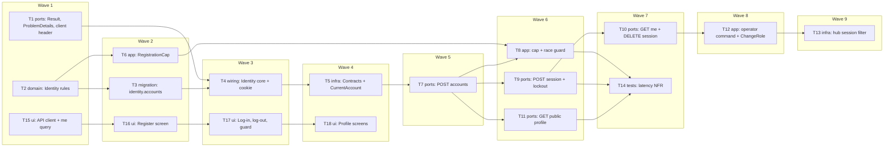

# Epic — accounts

> **Spec:** [spec.md](../spec.md) · **Design:** [sad.md](../sad.md) · **Data model:** [data-model.md](../data-model.md) · **API:** [openapi.yaml](../contracts/openapi.yaml) · **ADRs:** [adr/](../adr/)

## Goal

Give Rochambeau identity. A Visitor registers and is logged in as a Player in one submission. A Player logs in and out and sees their own and other Players' Profiles. The Administrator role exists from day one and only the operator grants it (spec §2). The epic also ships the identity seam (`Modules/Identity/Contracts/`) that roadmap steps 3 and 6 build on. Size **M**, route **standard**, surfaces `[backend-service, web-frontend]`.

## Scope

- **In:** the shared kernel's `Result<T>` / `Error`, ProblemDetails mapping and CSRF client-header filter (`Common/Results`, `Common/Http`), plus the operator-command hook (`Common/Commands`). The new `Identity` module: Domain rules, the `identity.accounts` table and migration, Identity core and cookie session, Contracts, register / log in / log out / own and public Profile endpoints, the registration cap, the `grant-admin` / `revoke-admin` commands and the hub session filter. In the SPA: the shared API client and the Register, Log-in and Profile screens.
- **Out (spec §3):** email confirmation and password reset; editing the profile or Username; deleting, deactivating or banning an account; social login; granting the admin role through the portal; player lists or search; token login; 2FA; a Moderator role.

## Task map

The backend lane (T1–T14) and the SPA lane (T15–T18) are independent from wave 1. The SPA works from `contracts/openapi.yaml` with a mocked `fetch`. Inside the backend, T2→T6 (registration cap) runs in parallel with T3–T5, and T9 / T11 can run in parallel after T7.

## Tasks

See [tracker.md](./tracker.md) for status. Machine contract: [tasks.json](../tasks.json).

| # | Task | Layer | Blocked by | DoD (short) |
|---|---|---|---|---|
| T1 | [Add Result/Error, the ProblemDetails mapping and the client-header filter to Common](./t01-common-results-problemdetails-client-header.md) | ports | — | Mapping unit tests + missing-header → 400 integration test pass |
| T2 | [Encode the Identity domain rules](./t02-identity-domain-rules.md) | domain | — | Boundary unit tests pass; Domain is framework-free |
| T3 | [Map the Account entity and promote the staged migration](./t03-account-entity-and-migration.md) | migration | T2 | Migration applies + reverts; unique/CHECK constraints proven by test |
| T4 | [Wire Identity core, the cookie session and deny-by-default authorization](./t04-identity-core-cookie-session-wiring.md) | wiring | T1, T3 | Anonymous → 401 no-redirect; options asserted; smoke test green |
| T5 | [Expose ICurrentAccount and IAccountDirectory through Identity Contracts](./t05-identity-contracts-current-account.md) | infra | T4 | Contracts + implementations; mapping, directory and architecture tests pass |
| T6 | [Implement the in-process RegistrationCap sliding window](./t06-registration-cap.md) | app | T2 | Sliding-window unit tests (incl. parallel) pass |
| T7 | [Register an Account through POST /api/v1/accounts](./t07-register-endpoint.md) | ports | T5 | Register endpoint; AC-01/02/03/14 integration tests pass |
| T8 | [Enforce the registration cap and prove the race guard](./t08-registration-cap-and-race-guard.md) | app | T6, T7 | Cap + race integration tests pass with a fake clock |
| T9 | [Log in through POST /api/v1/session with lockout](./t09-login-endpoint-lockout.md) | ports | T7 | Login endpoint; AC-04/05/06 integration tests pass |
| T10 | [Serve GET /api/v1/me and log out with DELETE /api/v1/session](./t10-own-profile-and-logout.md) | ports | T9 | /me + logout; AC-07/08/09/10 incl. session-lifetime test pass |
| T11 | [Serve the public Profile through GET /api/v1/profiles/{username}](./t11-public-profile-endpoint.md) | ports | T7 | Public profile endpoint; AC-10/11/12 tests pass |
| T12 | [Add the operator-command hook and the ChangeRole flow](./t12-operator-command-change-role.md) | app | T10 | Operator command + ChangeRole; AC-13/13b/14 tests pass; docs updated |
| T13 | [Revalidate the session on every hub invocation](./t13-session-revalidation-hub-filter.md) | infra | T12 | Hub filter aborts revoked connections; AC-13b hub test passes |
| T14 | [Measure the spec §6 latency targets](./t14-latency-nfr-tests.md) | tests | T8, T9, T11 | p95 latency tests for register/login/profile pass |
| T15 | [Add the shared API client and the «me» query to the SPA](./t15-web-api-client-and-me-query.md) | ui | — | API client + useMe with Vitest tests |
| T16 | [Build the Register screen with field-level errors](./t16-web-register-screen.md) | ui | T15 | Register screen states covered by RTL tests |
| T17 | [Build the Log-in screen, the log-out action and the route guard](./t17-web-login-logout-route-guard.md) | ui | T16 | Login/logout/guard states covered by RTL tests |
| T18 | [Build the own Profile and public Profile screens](./t18-web-profile-screens.md) | ui | T17 | Profile screens covered by RTL tests |

## Risks / Hard rules

- **Module boundaries:** other modules reach Identity only through `Modules/Identity/Contracts/`. `Common/` and `AppDbContext` never reference an Identity type (CLAUDE.md · Conventions, accounts ADR-0001, ADR-0004). The QG-4 architecture test in T5 enforces this.
- **Race guard = database:** the unique indexes `ix_accounts_normalized_user_name` / `ix_accounts_normalized_email` are the only race guard. Never check, then insert (sad §6). Keep the index names stable (data-model).
- **No role writer in the portal:** registration always writes `player`, and only the operator command changes `role` (accounts ADR-0003, AC-14).
- **Email exposure:** only `OwnProfile` carries an email. `PublicProfile` and `AccountIdentity` have no email field (sad §8).
- **Time:** inject `TimeProvider` everywhere. Lockout (T9), the cap (T6, T8) and session lifetime (T10) are proven with a fake clock.
- **No new infrastructure:** the registration cap and the Data Protection keys are per instance. Moving them needs an ADR before a second instance runs (sad §7, §11).
- **Capacity (sad §11):** the backend lane is ordered so that `Contracts/` (T5) lands early, and roadmap step 3 can be specified against it before the screens are done.
- **Open items carried into tasks:** OQ-1, registering while logged in (T7 uses the contract default). Spec §8 proxy address for the cap (T8 uses the connection's remote address, plus a breakdown default for a null address). No `screens.md` / `docs/design-system.md`, so T16 fixes a minimal screen contract.
- **No e2e task for the spec §7 demo KPI (QG-5):** the repo has no e2e runner yet. `/sdd:plan-tests accounts` picks the tier.
