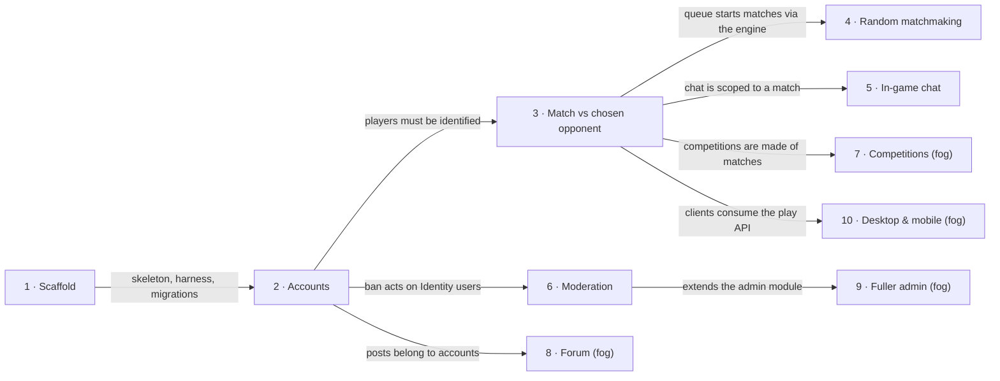

# Roadmap — Rochambeau

> **A decomposition, not a promise.** The overall idea broken into incremental steps: what each
> step is, where it comes from, how big it is — or that nobody has looked at it yet — and in which
> order, and parallel lanes, we walk them. **No dates** (except shipped history), **no scores** —
> order is the prioritization. The *solution* for any step lives in its `docs/features/<slug>/`
> spec, not here.

## Destination

Players on the web can play real-time rock-paper-scissors against a chosen or random opponent, chat in game and on a forum, and compete in tournaments and leagues while administrators run the portal — a working full-stack system that can be shown to others.

## Steps

| # | Step | Source | Size | Status |
|---|---|---|:---:|---|
| 1 | Scaffold the skeleton — host, test harness + smoke test, migration tooling, CI (`/sdd:scaffold`) | `architecture-map.md` · Module inventory; `docs/features/_scaffold/tasks.json` | S | idea |
| 2 | Accounts — a visitor can register, log in, and see their profile | `idea-brief.md` · 7. Recommendation | M | idea |
| 3 | Real-time match against a chosen opponent — challenge a named player, both commit hidden moves, the server reveals the result | `idea-brief.md` · 7. Recommendation | L | idea |
| 4 | Random matchmaking — join a queue and get paired into a match with whoever else is waiting | `idea-brief.md` · 7. Recommendation | S | idea |
| 5 | In-game chat — the two players of a match can message each other during it | `idea-brief.md` · 7. Recommendation | S | idea |
| 6 | Minimal moderation — an administrator can ban a user, who can then no longer log in or play | `idea-brief.md` · 7. Recommendation | S | idea |
| 7 | Competitions: tournaments and leagues → see [Not yet specified](#not-yet-specified) | `idea-brief.md` · 7. Recommendation | fog | idea |
| 8 | Forum → see [Not yet specified](#not-yet-specified) | `idea-brief.md` · 1. Raw idea | fog | idea |
| 9 | Fuller admin section → see [Not yet specified](#not-yet-specified) | `idea-brief.md` · 3. Users | fog | idea |
| 10 | Desktop and mobile clients → see [Not yet specified](#not-yet-specified) | `idea-brief.md` · 5. Out of scope | fog | idea |

## Not yet specified

| Area | What we'd have to learn | Blocks | How it gets sharpened |
|---|---|:---:|---|
| Competitions | What a tournament is vs a league (bracket vs season ranking), how entry works, how results feed standings | 7 | Grilling session with the owner once core play ships, then `/sdd:specify` |
| Forum | Build in-house or integrate an existing forum; what ties it to accounts | 8 | Owner decision D2, then a short recon of integration options if "integrate" |
| Fuller admin section | What administrators manage beyond banning (content, competitions, forum, reports) | 9 | Grilling session with the owner after moderation and competitions exist |
| Desktop and mobile clients | Which platforms, native vs wrapped web, what the server API must expose for them | 10 | Recon pass after the web client is complete |

## Out of scope

- Monetisation and growth work — no real audience is targeted; the purpose is learning / portfolio (`idea-brief.md` · 5. Out of scope).
- Infrastructure beyond the modular monolith (broker, cache, separate services) without an ADR — solo capacity constraint (`architecture-map.md` · Constraints & known tech-debt).

## Open decisions

| # | Question | Type | Owner | Blocks |
|---|---|:---:|:---:|:---:|
| D1 | Match format: single throw, best-of-N, or a variant such as RPS-Lizard-Spock? | grilling | human | 3 |
| D2 | Forum: build it in-house or integrate an existing one? | grilling | human | 8 |
| D3 | How do tournaments differ from leagues? | grilling | human | 7 |
| D4 | What does the admin section manage beyond moderation? | grilling | human | 9 |
| D5 | Install the .NET 10 SDK, Docker Desktop and Node.js LTS so the scaffold smoke test can pass | task | human | 1 |
| D6 | Push the repo to a GitHub remote so CI can run | task | human | 1 |

## Decisions so far

- Core play first; competitions, forum, fuller admin and native clients come later → [`docs/idea-brief.md` §7](idea-brief.md)
- Chosen-opponent challenge comes before random matchmaking (owner, roadmap review) → [Steps](#steps)
- Stack: .NET 10 + React/TypeScript + PostgreSQL + SignalR → [ADR-0001](adr/0001-use-dotnet-react-postgres-signalr-stack.md)
- Modular monolith with feature folders → [ADR-0002](adr/0002-use-modular-monolith-with-feature-folders.md)
- One EF Core `DbContext`, one schema per module → [ADR-0003](adr/0003-use-ef-core-single-dbcontext-schema-per-module.md)

## Dependency graph

## Execution path

All zones are targets from `docs/architecture-map.md` · Module inventory; none exist yet (greenfield), so each is marked `(new)`. Re-cut after `/sdd:survey` runs post-scaffold.

| Wave | Steps | Zone per step (why parallel-safe) | Unlocks |
|:---:|---|---|---|
| 1 | 1 | Host + Common + tests: `src/Rochambeau.Api/`, `tests/`, `web/` (new) | 2 |
| 2 | 2 | Identity: `src/Rochambeau.Api/Modules/Identity/`, `web/src/features/auth/` (new) | 3, 6 |
| 3 | 3 ∥ 6 | 3: Play `Modules/Play/` + `web/src/features/play/` (new) · 6: Admin `Modules/Admin/` + `web/src/features/admin/` (new) — disjoint modules; the ban uses Identity lockout, so no migration and no EF snapshot conflict; only a one-line `Program.cs` registration each | 4, 5 |
| 4 | 4 ∥ 5 | 4: Play matchmaking `Modules/Play/` (new) · 5: Chat `Modules/Chat/` + `web/src/features/chat/` (new) — disjoint modules; if both add a migration, regenerate the second lane's migration after rebasing so the EF snapshot stays linear | — |

## Shipped

| Step | Shipped | Link |
|---|---|---|
| — | — | — |
